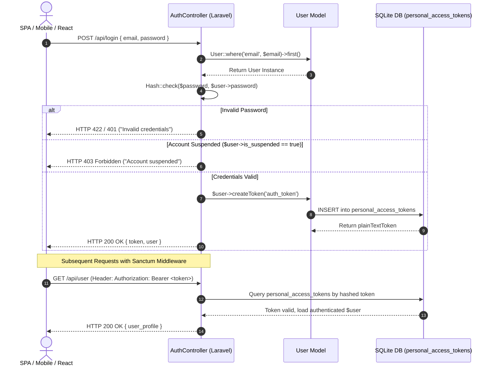
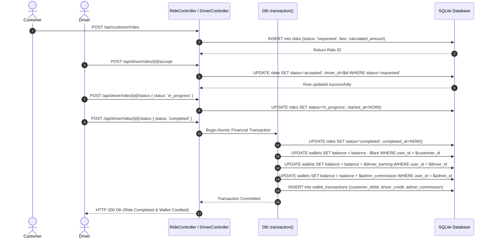
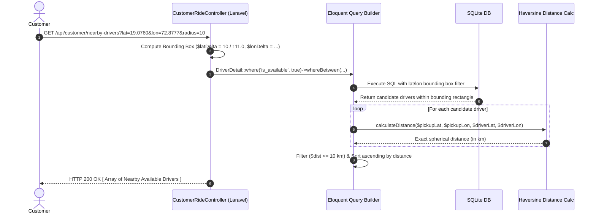

# 🚖 Indian Cabs — PHP Backend (`cab-backend-php`) Documentation

> **Tech Stack:** PHP 8.3+ · Laravel 13 · SQLite · Eloquent ORM · Laravel Sanctum

---

## Table of Contents

1. [Introduction](#1-introduction)
2. [Technology Stack](#2-technology-stack)
3. [System Architecture](#3-system-architecture)
4. [Project Structure](#4-project-structure)
5. [Database Design](#5-database-design)
   - [Database Schema (Migrations)](#51-database-schema-migrations)
   - [Eloquent Models & Relationships](#52-eloquent-models--relationships)
   - [ER Diagram](#53-er-diagram)
6. [Getting Started (Setup & Installation)](#6-getting-started-setup--installation)
7. [Environment Configuration](#7-environment-configuration)
8. [Authentication & Authorization](#8-authentication--authorization)
   - [Laravel Sanctum](#81-laravel-sanctum)
   - [Role-Based Middleware](#82-role-based-middleware)
   - [Suspended Account Handling](#83-suspended-account-handling)
9. [API Route Definitions](#9-api-route-definitions)
10. [Backend API Reference](#10-backend-api-reference)
    - [Authentication Endpoints](#101-authentication-endpoints)
    - [Customer Endpoints](#102-customer-endpoints)
    - [Driver Endpoints](#103-driver-endpoints)
    - [Admin Endpoints](#104-admin-endpoints)
    - [Wallet Endpoints](#105-wallet-endpoints)
11. [Business Logic](#11-business-logic)
    - [Fare Calculation](#111-fare-calculation)
    - [Ride Lifecycle](#112-ride-lifecycle)
    - [Driver Matching (Haversine Formula)](#113-driver-matching-haversine-formula)
    - [Payment & Commission](#114-payment--commission)
    - [Wallet System](#115-wallet-system)
12. [Seed Data & Testing](#12-seed-data--testing)
    - [Database Seeder](#121-database-seeder)
    - [Feature Tests](#122-feature-tests)
13. [Error Handling](#13-error-handling)
14. [Deployment & Scripts](#14-deployment--scripts)
15. [Book References](#15-book-references)

---

## 1. Introduction

**Indian Cabs — PHP Backend** (`cab-backend-php`) is the alternative server-side implementation of the Indian Cabs Cab Booking System, built using the **Laravel** framework (PHP). It provides a fully functional RESTful API that mirrors the same business logic and endpoint structure as the Node.js backend (`cab-backend-node`), allowing the React frontend (`cab-frontend`) to seamlessly switch between either backend without any frontend code changes.

The backend implements the complete cab booking lifecycle — from user registration and authentication, through ride request and driver matching, to fare calculation, wallet-based payments, commission splitting, and post-ride reviews. It is designed following Laravel's MVC (Model-View-Controller) pattern with Eloquent ORM for database interactions and Laravel Sanctum for stateless API token authentication.

### Key Highlights

| Feature | Implementation |
|---|---|
| **Framework** | Laravel 13 (PHP 8.3+) |
| **Database** | SQLite (development) / MySQL (production-ready) |
| **Authentication** | Laravel Sanctum token-based API authentication |
| **ORM** | Eloquent with PHP 8 Attribute syntax (`#[Fillable]`, `#[Hidden]`) |
| **Authorization** | Custom `CheckRole` middleware with role & suspension validation |
| **Geolocation** | Haversine formula for proximity-based driver/ride matching |
| **Payments** | Wallet system with deposit, payment, refund; configurable commission split |
| **Testing** | PHPUnit feature tests covering full API lifecycle |

---

## 2. Technology Stack

| Technology | Version | Purpose |
|---|---|---|
| **PHP** | 8.3+ | Server-side scripting language providing the runtime environment |
| **Laravel** | 13.17+ | Full-featured MVC web application framework with routing, middleware, ORM, and CLI tools |
| **Laravel Sanctum** | 4.0+ | Lightweight SPA/API token-based authentication system |
| **Eloquent ORM** | — | Active Record-based database abstraction layer built into Laravel |
| **SQLite** | — | File-based relational database used for development (zero-config) |
| **Composer** | 2.x | PHP dependency manager for package installation and autoloading |
| **PHPUnit** | 12.5+ | PHP testing framework for unit and feature tests |
| **Laravel Tinker** | 3.0+ | Interactive REPL for interacting with the application from the command line |
| **Faker** | 1.23+ | Library for generating fake data for database seeding and testing |
| **Laravel Pint** | 1.27+ | Opinionated code style fixer based on PHP-CS-Fixer |
| **Vite** | — | Frontend asset bundler (for Laravel Blade views, not used in API-only mode) |

### Development Dependencies

| Package | Purpose |
|---|---|
| `fakerphp/faker` | Generate realistic seed/test data |
| `laravel/pail` | Real-time log viewer |
| `laravel/pao` | Laravel profiling & observability |
| `laravel/pint` | PHP code style enforcement |
| `mockery/mockery` | Mock objects for testing |
| `nunomaduro/collision` | Beautiful error reporting for CLI |
| `phpunit/phpunit` | Automated testing framework |

---

## 3. System Architecture

The PHP backend follows Laravel's standard **MVC architecture** with the following layers:

```
┌──────────────────────────────────────────────────────────────────────┐
│                         CLIENT (React SPA)                          │
│                      cab-frontend (port 5173)                       │
└──────────────────────────────┬───────────────────────────────────────┘
                               │ HTTP REST API (JSON)
                               ▼
┌──────────────────────────────────────────────────────────────────────┐
│                      LARAVEL APPLICATION                            │
│                    cab-backend-php (port 8000)                       │
│                                                                      │
│  ┌────────────┐  ┌──────────────┐  ┌──────────────────────────────┐ │
│  │   Routes   │→ │  Middleware   │→ │       Controllers           │ │
│  │ (api.php)  │  │ (Sanctum +   │  │ (Auth, Customer, Driver,    │ │
│  │            │  │  CheckRole)  │  │  Admin, Wallet)             │ │
│  └────────────┘  └──────────────┘  └──────────────┬───────────────┘ │
│                                                    │                 │
│                                     ┌──────────────▼───────────────┐ │
│                                     │    Eloquent Models (ORM)     │ │
│                                     │ User, Ride, Payment, Review, │ │
│                                     │ DriverDetail, Wallet,        │ │
│                                     │ WalletTransaction            │ │
│                                     └──────────────┬───────────────┘ │
└──────────────────────────────────────┬─────────────┘                 │
                                       │                               │
                              ┌────────▼────────┐                     │
                              │     SQLite DB    │                     │
                              │ (database.sqlite)│                     │
                              └─────────────────┘                     │
└──────────────────────────────────────────────────────────────────────┘
```

### Request Lifecycle

1. **Client** sends HTTP request to `http://localhost:8000/api/...`
2. **Routes** (`routes/api.php`) map the URI and HTTP method to a Controller action
3. **Middleware** pipeline runs:
   - `auth:sanctum` — validates Bearer token and loads authenticated user
   - `role:customer|driver|admin` — verifies user role and account status
4. **Controller** executes business logic, validates input, interacts with Models
5. **Eloquent Models** translate operations to SQL queries on the SQLite database
6. **Response** is returned as JSON to the client

---

## 4. Project Structure

```
cab-backend-php/
├── app/
│   ├── Http/
│   │   ├── Controllers/
│   │   │   ├── AuthController.php          # Registration, Login, Logout, Profile
│   │   │   ├── CustomerRideController.php  # Ride booking, history, cancel, rate, nearby drivers
│   │   │   ├── DriverController.php        # Location update, ride requests, accept, status, vehicle CRUD
│   │   │   ├── AdminController.php         # Dashboard stats, user management, ride listing
│   │   │   ├── WalletController.php        # Wallet balance, recharge
│   │   │   ├── Controller.php              # Base controller class
│   │   │   └── PostController.php          # (Unused scaffold)
│   │   ├── Middleware/
│   │   │   └── CheckRole.php               # Custom role-based access control middleware
│   │   ├── Requests/
│   │   │   └── StorePostRequest.php        # (Unused scaffold)
│   │   └── Resources/
│   │       └── UserResource.php            # API resource transformer for User
│   ├── Models/
│   │   ├── User.php                        # User model (Customer/Driver/Admin)
│   │   ├── DriverDetail.php                # Driver vehicle & location details
│   │   ├── Ride.php                        # Ride/booking model with status constants
│   │   ├── Payment.php                     # Payment record per ride
│   │   ├── Review.php                      # Post-ride rating & comment
│   │   ├── Wallet.php                      # User wallet balance
│   │   └── WalletTransaction.php           # Individual wallet transaction record
│   └── Providers/
├── bootstrap/
├── config/
│   ├── app.php                             # Application configuration
│   ├── auth.php                            # Authentication guards & providers
│   ├── cab.php                             # ★ Custom: Commission % & vehicle fare rates
│   ├── database.php                        # Database connection settings
│   ├── sanctum.php                         # Sanctum configuration
│   └── ...                                 # Other Laravel config files
├── database/
│   ├── database.sqlite                     # SQLite database file
│   ├── migrations/
│   │   ├── create_users_table.php          # Users + Sessions schema
│   │   ├── create_driver_details_table.php # Driver vehicle & GPS data
│   │   ├── create_rides_table.php          # Ride bookings schema
│   │   ├── create_payments_table.php       # Payment records schema
│   │   ├── create_reviews_table.php        # Review/rating schema
│   │   ├── create_wallets_...tables.php    # Wallets & Wallet Transactions
│   │   ├── add_pickup_waiting_...php       # Adds pickup_waiting_started_at to rides
│   │   └── add_acceptance_and_...php       # Adds driver_accepted_at, estimated_pickup_at
│   └── seeders/
│       └── DatabaseSeeder.php              # Seeds Customer, Driver, and Admin accounts
├── routes/
│   ├── api.php                             # ★ All API route definitions
│   ├── web.php                             # Web routes (minimal)
│   └── console.php                         # Console/Artisan commands
├── tests/
│   ├── Feature/
│   │   ├── CabBookingApiTest.php           # Comprehensive API lifecycle tests
│   │   └── CustomerWalletIsolationTest.php # Wallet isolation test
│   └── Unit/
├── .env.example                            # Environment variable template
├── composer.json                           # PHP dependencies & scripts
├── phpunit.xml                             # PHPUnit test configuration
├── artisan                                 # Laravel CLI entry point
└── api_documentation.md                    # Quick API reference
```

---

## 5. Database Design

### 5.1 Database Schema (Migrations)

The database uses **SQLite** for development and is defined through Laravel migrations. The schema consists of 7 primary tables:

#### `users` Table

| Column | Type | Constraints | Description |
|---|---|---|---|
| `id` | BIGINT (auto) | PRIMARY KEY | Unique user identifier |
| `name` | VARCHAR(255) | NOT NULL | User's full name |
| `email` | VARCHAR(255) | UNIQUE, NOT NULL | Login email address |
| `phone` | VARCHAR(255) | UNIQUE, NOT NULL | Contact phone number |
| `role` | VARCHAR(255) | DEFAULT 'customer' | Role: `customer`, `driver`, `admin` |
| `status` | VARCHAR(255) | DEFAULT 'active' | Status: `active`, `suspended` |
| `email_verified_at` | TIMESTAMP | NULLABLE | Email verification timestamp |
| `password` | VARCHAR(255) | NOT NULL | Bcrypt-hashed password |
| `remember_token` | VARCHAR(100) | NULLABLE | "Remember me" session token |
| `created_at` | TIMESTAMP | — | Record creation timestamp |
| `updated_at` | TIMESTAMP | — | Last update timestamp |

#### `driver_details` Table

| Column | Type | Constraints | Description |
|---|---|---|---|
| `id` | BIGINT (auto) | PRIMARY KEY | Unique record identifier |
| `user_id` | BIGINT | FOREIGN KEY → users.id, CASCADE | Associated driver user |
| `license_number` | VARCHAR(255) | UNIQUE | Driver's license number |
| `vehicle_model` | VARCHAR(255) | NOT NULL | Vehicle make and model |
| `vehicle_plate_number` | VARCHAR(255) | UNIQUE | Vehicle registration plate |
| `vehicle_color` | VARCHAR(255) | NOT NULL | Vehicle color |
| `vehicle_type` | VARCHAR(255) | NOT NULL | Type: `sedan`, `suv`, `hatchback`, `bike`, `rickshaw` |
| `is_available` | BOOLEAN | DEFAULT false | Online/offline availability status |
| `current_latitude` | DECIMAL(10,8) | NULLABLE | Current GPS latitude |
| `current_longitude` | DECIMAL(11,8) | NULLABLE | Current GPS longitude |
| `rating` | DECIMAL(3,2) | DEFAULT 5.00 | Aggregated average rating (1.00–5.00) |
| `created_at` | TIMESTAMP | — | Record creation timestamp |
| `updated_at` | TIMESTAMP | — | Last update timestamp |

#### `rides` Table

| Column | Type | Constraints | Description |
|---|---|---|---|
| `id` | BIGINT (auto) | PRIMARY KEY | Unique ride identifier |
| `customer_id` | BIGINT | FOREIGN KEY → users.id, CASCADE | Customer who booked |
| `driver_id` | BIGINT | FOREIGN KEY → users.id, SET NULL, NULLABLE | Assigned driver |
| `pickup_address` | VARCHAR(255) | NOT NULL | Pickup location text |
| `dropoff_address` | VARCHAR(255) | NOT NULL | Dropoff location text |
| `pickup_latitude` | DECIMAL(10,8) | NOT NULL | Pickup GPS latitude |
| `pickup_longitude` | DECIMAL(11,8) | NOT NULL | Pickup GPS longitude |
| `dropoff_latitude` | DECIMAL(10,8) | NOT NULL | Dropoff GPS latitude |
| `dropoff_longitude` | DECIMAL(11,8) | NOT NULL | Dropoff GPS longitude |
| `status` | VARCHAR(255) | DEFAULT 'requested' | Ride status (see lifecycle) |
| `pickup_waiting_started_at` | TIMESTAMP | NULLABLE | When driver arrived at pickup |
| `driver_accepted_at` | TIMESTAMP | NULLABLE | When driver accepted the ride |
| `estimated_pickup_at` | TIMESTAMP | NULLABLE | Estimated arrival at pickup |
| `vehicle_type` | VARCHAR(255) | NULLABLE | Vehicle category: `Car`, `Bike`, `Rickshaw` |
| `fare` | DECIMAL(8,2) | NULLABLE | Calculated fare amount (₹) |
| `distance` | DECIMAL(8,2) | NULLABLE | Trip distance in kilometers |
| `duration` | INTEGER | NULLABLE | Trip duration in minutes |
| `scheduled_at` | TIMESTAMP | NULLABLE | Scheduled pickup time (future rides) |
| `created_at` | TIMESTAMP | — | Record creation timestamp |
| `updated_at` | TIMESTAMP | — | Last update timestamp |

#### `payments` Table

| Column | Type | Constraints | Description |
|---|---|---|---|
| `id` | BIGINT (auto) | PRIMARY KEY | Unique payment identifier |
| `ride_id` | BIGINT | FOREIGN KEY → rides.id, CASCADE | Associated ride |
| `payment_method` | VARCHAR(255) | DEFAULT 'cash' | Method: `cash`, `card`, `wallet` |
| `payment_status` | VARCHAR(255) | DEFAULT 'pending' | Status: `pending`, `completed`, `failed`, `refunded` |
| `amount` | DECIMAL(8,2) | NOT NULL | Total fare amount |
| `admin_commission` | DECIMAL(8,2) | DEFAULT 0 | Platform commission amount |
| `driver_earning` | DECIMAL(8,2) | DEFAULT 0 | Driver's earning after commission |
| `is_payout_distributed` | BOOLEAN | DEFAULT false | Whether earnings have been distributed |
| `transaction_reference` | VARCHAR(255) | NULLABLE | External payment reference |
| `created_at` | TIMESTAMP | — | Record creation timestamp |
| `updated_at` | TIMESTAMP | — | Last update timestamp |

#### `reviews` Table

| Column | Type | Constraints | Description |
|---|---|---|---|
| `id` | BIGINT (auto) | PRIMARY KEY | Unique review identifier |
| `ride_id` | BIGINT | FOREIGN KEY → rides.id, CASCADE | Associated ride |
| `reviewer_id` | BIGINT | FOREIGN KEY → users.id, CASCADE | Customer who left the review |
| `reviewee_id` | BIGINT | FOREIGN KEY → users.id, CASCADE | Driver being reviewed |
| `rating` | INTEGER | NOT NULL | Rating value (1–5 stars) |
| `comment` | TEXT | NULLABLE | Optional review comment |
| `created_at` | TIMESTAMP | — | Record creation timestamp |
| `updated_at` | TIMESTAMP | — | Last update timestamp |

#### `wallets` Table

| Column | Type | Constraints | Description |
|---|---|---|---|
| `id` | BIGINT (auto) | PRIMARY KEY | Unique wallet identifier |
| `user_id` | BIGINT | FOREIGN KEY → users.id, UNIQUE, CASCADE | Wallet owner |
| `balance` | DECIMAL(10,2) | DEFAULT 0.00 | Current wallet balance (₹) |
| `created_at` | TIMESTAMP | — | Record creation timestamp |
| `updated_at` | TIMESTAMP | — | Last update timestamp |

#### `wallet_transactions` Table

| Column | Type | Constraints | Description |
|---|---|---|---|
| `id` | BIGINT (auto) | PRIMARY KEY | Unique transaction identifier |
| `wallet_id` | BIGINT | FOREIGN KEY → wallets.id, CASCADE | Associated wallet |
| `user_id` | BIGINT | FOREIGN KEY → users.id, CASCADE | Transaction owner |
| `type` | ENUM | `deposit`, `payment`, `refund` | Transaction type |
| `amount` | DECIMAL(10,2) | NOT NULL | Transaction amount (₹) |
| `description` | VARCHAR(255) | NOT NULL | Transaction description |
| `reference_id` | VARCHAR(255) | NULLABLE | Reference (e.g., ride ID) |
| `created_at` | TIMESTAMP | — | Record creation timestamp |
| `updated_at` | TIMESTAMP | — | Last update timestamp |

---

### 5.2 Eloquent Models & Relationships

```
User (Authenticatable)
 ├── hasOne → DriverDetail        (for driver role)
 ├── hasMany → Ride (as customer) (customer_id)
 ├── hasMany → Ride (as driver)   (driver_id)
 ├── hasOne → Wallet
 └── hasMany → WalletTransaction

DriverDetail
 └── belongsTo → User
 └── reviews_count (appended attribute via Review query)

Ride
 ├── belongsTo → User (customer)
 ├── belongsTo → User (driver)
 ├── hasOne → Payment
 └── hasMany → Review

Payment
 └── belongsTo → Ride

Review
 ├── belongsTo → Ride
 ├── belongsTo → User (reviewer)
 └── belongsTo → User (reviewee)

Wallet
 ├── belongsTo → User
 └── hasMany → WalletTransaction

WalletTransaction
 ├── belongsTo → Wallet
 └── belongsTo → User
```

#### Model Features

| Model | Special Features |
|---|---|
| **User** | PHP 8 `#[Fillable]` and `#[Hidden]` attributes; constants for roles (`ROLE_CUSTOMER`, `ROLE_DRIVER`, `ROLE_ADMIN`) and statuses (`STATUS_ACTIVE`, `STATUS_SUSPENDED`); `HasApiTokens` trait for Sanctum; `password` auto-cast to `hashed` |
| **DriverDetail** | `reviews_count` appended attribute computed via `Review::where('reviewee_id', ...)->count()`; boolean cast for `is_available`; float casts for coordinates and rating |
| **Ride** | Status constants (`STATUS_REQUESTED`, `STATUS_ACCEPTED`, `STATUS_ARRIVED`, `STATUS_WAITING_FOR_CUSTOMER`, `STATUS_IN_PROGRESS`, `STATUS_COMPLETED`, `STATUS_CANCELLED`); datetime casts for `scheduled_at`, `pickup_waiting_started_at`, `driver_accepted_at`, `estimated_pickup_at` |
| **Payment** | Float casts for monetary fields; boolean cast for `is_payout_distributed` |
| **Wallet** | `lockForUpdate()` used for atomic balance operations (pessimistic locking) |

---

### 5.3 ER Diagram

```
┌────────────────────┐       1:1       ┌─────────────────────────┐
│       users        │────────────────→│     driver_details      │
│────────────────────│                 │─────────────────────────│
│ id (PK)            │                 │ id (PK)                 │
│ name               │                 │ user_id (FK → users)    │
│ email (UNIQUE)     │                 │ license_number (UNIQUE) │
│ phone (UNIQUE)     │                 │ vehicle_model           │
│ role               │                 │ vehicle_plate_number    │
│ status             │                 │ vehicle_color           │
│ password           │                 │ vehicle_type            │
│ created_at         │                 │ is_available            │
│ updated_at         │                 │ current_latitude        │
└────────┬───────────┘                 │ current_longitude       │
         │                             │ rating                  │
         │ 1:N (customer)             └─────────────────────────┘
         │
         ▼
┌────────────────────────┐     1:1     ┌──────────────────────────┐
│         rides          │────────────→│        payments          │
│────────────────────────│             │──────────────────────────│
│ id (PK)                │             │ id (PK)                  │
│ customer_id (FK)       │             │ ride_id (FK → rides)     │
│ driver_id (FK, NULL)   │             │ payment_method           │
│ pickup_address         │             │ payment_status           │
│ dropoff_address        │             │ amount                   │
│ pickup_latitude        │             │ admin_commission         │
│ pickup_longitude       │             │ driver_earning           │
│ dropoff_latitude       │             │ is_payout_distributed    │
│ dropoff_longitude      │             │ transaction_reference    │
│ status                 │             └──────────────────────────┘
│ vehicle_type           │
│ fare                   │     1:N     ┌──────────────────────────┐
│ distance               │────────────→│        reviews           │
│ duration               │             │──────────────────────────│
│ scheduled_at           │             │ id (PK)                  │
│ pickup_waiting_started │             │ ride_id (FK → rides)     │
│ driver_accepted_at     │             │ reviewer_id (FK → users) │
│ estimated_pickup_at    │             │ reviewee_id (FK → users) │
└────────────────────────┘             │ rating                   │
                                       │ comment                  │
         │                             └──────────────────────────┘
         │ 1:1 (user)
         ▼
┌────────────────────────┐     1:N     ┌──────────────────────────┐
│        wallets         │────────────→│   wallet_transactions    │
│────────────────────────│             │──────────────────────────│
│ id (PK)                │             │ id (PK)                  │
│ user_id (FK, UNIQUE)   │             │ wallet_id (FK → wallets) │
│ balance                │             │ user_id (FK → users)     │
└────────────────────────┘             │ type (enum)              │
                                       │ amount                   │
                                       │ description              │
                                       │ reference_id             │
                                       └──────────────────────────┘
```

---

## 6. Getting Started (Setup & Installation)

### Prerequisites

| Software | Version | Purpose |
|---|---|---|
| PHP | 8.3+ | Server runtime |
| Composer | 2.x | PHP dependency management |
| Node.js | 18+ | Frontend build tooling (Vite) |
| npm | 9+ | Frontend package management |

### Installation Steps

```bash
# 1. Navigate to the backend directory
cd cab-backend-php

# 2. Install PHP dependencies
composer install

# 3. Copy the environment configuration file
cp .env.example .env

# 4. Generate application encryption key
php artisan key:generate

# 5. Create SQLite database file (if not present)
touch database/database.sqlite

# 6. Run database migrations
php artisan migrate

# 7. Seed default accounts (Customer, Driver, Admin)
php artisan db:seed

# 8. Start the development server
php artisan serve --host=0.0.0.0 --port=8000
```

### Quick Start (Composer Script)

```bash
composer setup
```

This runs `composer install`, copies `.env`, generates the app key, runs migrations, installs npm dependencies, and builds frontend assets.

### Using the Shell Script (from project root)

```bash
./start.sh php   # Starts the PHP backend + React frontend
```

---

## 7. Environment Configuration

### `.env` File Reference

| Variable | Default | Description |
|---|---|---|
| `APP_NAME` | `Laravel` | Application name |
| `APP_ENV` | `local` | Environment mode (`local`, `production`, `testing`) |
| `APP_KEY` | — | Encryption key (auto-generated via `php artisan key:generate`) |
| `APP_DEBUG` | `true` | Debug mode (disable in production) |
| `APP_URL` | `http://localhost:8000` | Base URL of the application |
| `DB_CONNECTION` | `sqlite` | Database driver (`sqlite`, `mysql`, `pgsql`) |
| `DB_HOST` | `127.0.0.1` | Database host (MySQL/PostgreSQL) |
| `DB_PORT` | `3306` | Database port |
| `DB_DATABASE` | `laravel` | Database name |
| `DB_USERNAME` | `root` | Database username |
| `DB_PASSWORD` | — | Database password |
| `BCRYPT_ROUNDS` | `12` | Bcrypt hashing cost (higher = more secure, slower) |
| `SESSION_DRIVER` | `database` | Session storage driver |
| `CACHE_STORE` | `database` | Cache storage driver |
| `QUEUE_CONNECTION` | `database` | Queue driver |

### Custom Configuration (`config/cab.php`)

```php
return [
    'commission_percentage' => 10,    // Admin commission as % of fare
    'vehicle_rates' => [
        'car' => 30,       // ₹30 per km for Car (sedan/suv/hatchback)
        'bike' => 10,      // ₹10 per km for Bike
        'rickshaw' => 20,  // ₹20 per km for Rickshaw
    ],
];
```

Access in controllers: `config('cab.commission_percentage')`, `config('cab.vehicle_rates.car')`

---

## 8. Authentication & Authorization

### 8.1 Laravel Sanctum

Authentication uses **Laravel Sanctum** for token-based API authentication. Sanctum issues plain-text tokens via `personal_access_tokens` table.



**Flow:**

1. **Registration/Login** → Server creates user, generates Sanctum token
2. **Token Storage** → Client stores token in `localStorage`
3. **Authenticated Requests** → Client sends `Authorization: Bearer <token>` header
4. **Server Validation** → `auth:sanctum` middleware validates token, loads user
5. **Logout** → Server deletes the current access token

```php
// Creating a token (AuthController)
$token = $user->createToken('auth_token')->plainTextToken;

// Deleting on logout
$request->user()->currentAccessToken()->delete();
```

### 8.2 Role-Based Middleware

The custom `CheckRole` middleware (`app/Http/Middleware/CheckRole.php`) enforces role-based access:

```php
class CheckRole
{
    public function handle(Request $request, Closure $next, ...$roles): Response
    {
        $user = $request->user();

        // Check if user has the required role
        if (!$user || !in_array($user->role, $roles)) {
            return response()->json([
                'message' => 'Unauthorized access. Requires role: ' . implode(' or ', $roles)
            ], 403);
        }

        // Check if account is suspended
        if ($user->status === User::STATUS_SUSPENDED) {
            return response()->json([
                'message' => 'Your account has been suspended by an administrator.'
            ], 403);
        }

        return $next($request);
    }
}
```

**Usage in Routes:**

```php
Route::middleware('role:customer')->group(function () { ... });
Route::middleware('role:driver')->group(function () { ... });
Route::middleware('role:admin')->group(function () { ... });
```

### 8.3 Suspended Account Handling

Account suspension is checked at two levels:

1. **Login Time** — `AuthController::login()` returns `403` if user status is `suspended`
2. **Every Request** — `CheckRole` middleware blocks all API access for suspended accounts

---

## 9. API Route Definitions

All routes are defined in `routes/api.php` and prefixed with `/api`:

```
PUBLIC ROUTES (No Auth Required)
  POST   /api/register              → AuthController@register
  POST   /api/login                 → AuthController@login

AUTHENTICATED ROUTES (auth:sanctum)
  POST   /api/logout                → AuthController@logout
  GET    /api/me                    → AuthController@me

  CUSTOMER ROUTES (role:customer)
    GET    /api/customer/drivers/nearby       → CustomerRideController@nearbyDrivers
    POST   /api/customer/rides               → CustomerRideController@store
    GET    /api/customer/rides               → CustomerRideController@index
    GET    /api/customer/rides/{id}          → CustomerRideController@show
    POST   /api/customer/rides/{id}/cancel   → CustomerRideController@cancel
    POST   /api/customer/rides/{id}/rate     → CustomerRideController@rate
    GET    /api/customer/wallet              → WalletController@getWallet
    POST   /api/customer/wallet/recharge     → WalletController@recharge

  DRIVER ROUTES (role:driver)
    POST   /api/driver/location              → DriverController@updateLocation
    GET    /api/driver/rides/requests        → DriverController@rideRequests
    POST   /api/driver/rides/{id}/accept     → DriverController@acceptRide
    POST   /api/driver/rides/{id}/status     → DriverController@updateStatus
    POST   /api/driver/rides/{id}/cancel     → DriverController@cancelRide
    GET    /api/driver/rides                 → DriverController@rideHistory
    POST   /api/driver/vehicle               → DriverController@registerVehicle
    PUT    /api/driver/vehicle               → DriverController@updateVehicle
    DELETE /api/driver/vehicle               → DriverController@deleteVehicle

  ADMIN ROUTES (role:admin)
    GET    /api/admin/dashboard              → AdminController@dashboard
    GET    /api/admin/users                  → AdminController@users
    PATCH  /api/admin/users/{id}/status      → AdminController@updateUserStatus
    DELETE /api/admin/users/{id}             → AdminController@deleteDriver
    GET    /api/admin/rides                  → AdminController@rides
```

**Total Endpoints:** 21 (2 public + 2 shared + 8 customer + 7 driver + 5 admin)

---

## 10. Backend API Reference

### 10.1 Authentication Endpoints

#### Register User
- **Method:** `POST`
- **Endpoint:** `/api/register`
- **Access:** Public
- **Request Body (Customer):**
  ```json
  {
    "name": "John Doe",
    "email": "john@example.com",
    "phone": "+1234567890",
    "password": "password123",
    "password_confirmation": "password123",
    "role": "customer"
  }
  ```
- **Request Body (Driver):**
  ```json
  {
    "name": "Jane Driver",
    "email": "jane@example.com",
    "phone": "+1234567891",
    "password": "password123",
    "password_confirmation": "password123",
    "role": "driver",
    "license_number": "DL-987654321",
    "vehicle_model": "Toyota Prius",
    "vehicle_plate_number": "TX-777-YY",
    "vehicle_color": "White",
    "vehicle_type": "sedan"
  }
  ```
- **Validation Rules:**
  - `name`: required, string, max 255
  - `email`: required, email, unique
  - `phone`: required, string, max 20, unique
  - `password`: required, min 6, confirmed
  - `role`: required, in `customer,driver`
  - Driver fields: `license_number` (unique), `vehicle_model`, `vehicle_plate_number` (unique), `vehicle_color`, `vehicle_type` (in `sedan,suv,hatchback,bike,rickshaw`)
- **Response (201 Created):**
  ```json
  {
    "user": { "id": 1, "name": "John Doe", "email": "john@example.com", ... },
    "access_token": "1|abcdefghijklmnop...",
    "token_type": "Bearer"
  }
  ```

#### Login
- **Method:** `POST`
- **Endpoint:** `/api/login`
- **Access:** Public
- **Request Body:**
  ```json
  {
    "email": "john@example.com",
    "password": "password123"
  }
  ```
- **Response (200 OK):**
  ```json
  {
    "user": { "id": 1, "name": "John Doe", "role": "customer", ... },
    "access_token": "2|qrstuvwxyz...",
    "token_type": "Bearer"
  }
  ```
- **Error (403):** Account suspended → `"Your account has been suspended by an administrator."`

#### Get Authenticated Profile
- **Method:** `GET`
- **Endpoint:** `/api/me`
- **Access:** Authenticated
- **Response:** User object with `driverDetail` relation loaded

#### Logout
- **Method:** `POST`
- **Endpoint:** `/api/logout`
- **Access:** Authenticated
- **Response:** `{ "message": "Logged out successfully." }`

---

### 10.2 Customer Endpoints

All customer routes require `Authorization: Bearer <token>` and user role `customer`.

#### Search Nearby Drivers
- **Method:** `GET`
- **Endpoint:** `/api/customer/drivers/nearby`
- **Query Parameters:**
  - `latitude` (required, numeric, -90 to 90)
  - `longitude` (required, numeric, -180 to 180)
  - `radius` (optional, numeric, min 1, defaults to 10 km)
- **Logic:** Uses Haversine formula with bounding-box optimization to find available drivers within radius
- **Response (200 OK):**
  ```json
  {
    "drivers": [
      {
        "id": 1,
        "user_id": 2,
        "license_number": "DL-99999",
        "vehicle_model": "Toyota Camry",
        "vehicle_type": "sedan",
        "is_available": true,
        "current_latitude": 12.9716,
        "current_longitude": 77.5946,
        "rating": 4.90,
        "distance": 0.05,
        "user": { "id": 2, "name": "Dave Driver", "phone": "0987654321" }
      }
    ]
  }
  ```

#### Book / Request a Ride
- **Method:** `POST`
- **Endpoint:** `/api/customer/rides`
- **Request Body:**
  ```json
  {
    "pickup_address": "MG Road, Bangalore",
    "dropoff_address": "Indiranagar, Bangalore",
    "pickup_latitude": 12.9716,
    "pickup_longitude": 77.5946,
    "dropoff_latitude": 12.9784,
    "dropoff_longitude": 77.6408,
    "distance": 5.03,
    "vehicle_type": "car",
    "payment_method": "cash"
  }
  ```
- **Logic:**
  1. Validates input fields
  2. Determines vehicle rate from `config/cab.php`
  3. Calculates fare: `Distance × Rate`
  4. Checks driver availability for requested vehicle type
  5. If wallet payment, checks and deducts balance (atomic with `lockForUpdate()`)
  6. Creates Ride record (status: `requested`)
  7. Creates Payment record with commission split
  8. Returns ride with payment
- **Response (201 Created):**
  ```json
  {
    "message": "Ride requested successfully. Searching for nearby drivers...",
    "ride": { "id": 5, "status": "requested", "fare": 150.90, ... }
  }
  ```
- **Error (422):** No available drivers → suggests available vehicle types

#### List Ride History
- **Method:** `GET`
- **Endpoint:** `/api/customer/rides`
- **Response:** Paginated (15/page) list of rides with driver, payment, and reviews

#### Show Ride Details
- **Method:** `GET`
- **Endpoint:** `/api/customer/rides/{id}`
- **Response:** Single ride with all relations

#### Cancel Ride
- **Method:** `POST`
- **Endpoint:** `/api/customer/rides/{id}/cancel`
- **Logic:**
  1. Verifies ride is in `requested`, `accepted`, or `waiting_for_customer` status
  2. Sets status to `cancelled`
  3. If wallet payment was completed → refunds balance and creates `refund` transaction
  4. If driver was assigned → marks driver as available again
- **Response:** `{ "message": "Ride cancelled successfully.", "ride": {...} }`

#### Rate Driver
- **Method:** `POST`
- **Endpoint:** `/api/customer/rides/{id}/rate`
- **Request Body:**
  ```json
  { "rating": 5, "comment": "Excellent ride!" }
  ```
- **Logic:** Creates review, recalculates driver's average rating
- **Response (201):** `{ "message": "Review submitted successfully.", "review": {...} }`

---

### 10.3 Driver Endpoints

All driver routes require `Authorization: Bearer <token>` and user role `driver`.

#### Update Location & Availability
- **Method:** `POST`
- **Endpoint:** `/api/driver/location`
- **Request Body:**
  ```json
  { "latitude": 12.9716, "longitude": 77.5946, "is_available": true }
  ```

#### View Nearby Ride Requests
- **Method:** `GET`
- **Endpoint:** `/api/driver/rides/requests`
- **Logic:**
  1. Driver must be `is_available = true`
  2. Maps driver's vehicle type to ride vehicle type (`sedan/suv/hatchback → Car`, `bike → Bike`, `rickshaw → Rickshaw`)
  3. Finds `requested` rides within 15 km using Haversine formula
  4. Returns rides sorted by distance to pickup

#### Accept a Ride
- **Method:** `POST`
- **Endpoint:** `/api/driver/rides/{id}/accept`
- **Logic:**
  1. Validates driver is available and vehicle type matches
  2. Uses `lockForUpdate()` for atomic race-condition prevention
  3. Assigns driver, sets status to `accepted`, records timestamps
  4. Sets driver `is_available = false`

#### Update Trip Status
- **Method:** `POST`
- **Endpoint:** `/api/driver/rides/{id}/status`
- **Request Body:**
  ```json
  { "status": "waiting_for_customer" }
  ```
- **Status Progression:**
  ```
  accepted → waiting_for_customer → in_progress → completed
  ```
- **On Completion:**
  1. Calculates actual elapsed ride duration
  2. Sets driver back to `is_available = true`
  3. Marks payment as `completed`
  4. Deposits driver earning into driver's wallet
  5. Deposits admin commission into admin's wallet
  6. Creates wallet transaction records for both

#### Cancel Ride (Driver)
- **Method:** `POST`
- **Endpoint:** `/api/driver/rides/{id}/cancel`
- **Logic:** Sets ride to `cancelled`, marks driver as available

#### Ride History
- **Method:** `GET`
- **Endpoint:** `/api/driver/rides`
- **Response:** Paginated list of driver's rides

#### Vehicle CRUD

| Action | Method | Endpoint |
|---|---|---|
| Register | `POST` | `/api/driver/vehicle` |
| Update | `PUT` | `/api/driver/vehicle` |
| Delete | `DELETE` | `/api/driver/vehicle` |

---

### 10.4 Admin Endpoints

All admin routes require `Authorization: Bearer <token>` and user role `admin`.

#### Dashboard Statistics
- **Method:** `GET`
- **Endpoint:** `/api/admin/dashboard`
- **Response:**
  ```json
  {
    "stats": {
      "total_earnings": 1500.50,
      "total_completed_rides": 42,
      "total_users": 150,
      "active_drivers_online": 8
    }
  }
  ```
- **Note:** `total_earnings` is the sum of `admin_commission` from completed payments (not total fare)

#### List & Filter Users
- **Method:** `GET`
- **Endpoint:** `/api/admin/users`
- **Query Parameters:** `role`, `status`, `search` (searches name, email, phone)
- **Response:** Paginated (15/page) user list with driver details

#### Suspend / Activate User
- **Method:** `PATCH`
- **Endpoint:** `/api/admin/users/{id}/status`
- **Request Body:** `{ "status": "suspended" }` or `{ "status": "active" }`
- **Guard:** Admin cannot update their own account status

#### Delete Driver
- **Method:** `DELETE`
- **Endpoint:** `/api/admin/users/{id}`
- **Guards:**
  - Cannot delete own account
  - Only `driver` role accounts can be deleted
  - Cannot delete driver with active rides in progress
- **Logic:** Deletes driver details and user account

#### List All Rides
- **Method:** `GET`
- **Endpoint:** `/api/admin/rides`
- **Query Parameters:** `status`, `driver_id`, `customer_id`
- **Response:** Paginated rides with customer, driver, and payment details

---

### 10.5 Wallet Endpoints

#### Get Wallet Balance & Transactions
- **Method:** `GET`
- **Endpoint:** `/api/customer/wallet`
- **Response:**
  ```json
  {
    "balance": 500.00,
    "transactions": [
      { "id": 1, "type": "deposit", "amount": 500.00, "description": "Wallet Recharge Deposit", ... }
    ]
  }
  ```

#### Recharge Wallet
- **Method:** `POST`
- **Endpoint:** `/api/customer/wallet/recharge`
- **Request Body:** `{ "amount": 500 }`
- **Constraints:**
  - Minimum recharge: ₹1
  - Maximum wallet balance: ₹2,000
- **Logic:** Uses `lockForUpdate()` for atomic balance updates
- **Response:**
  ```json
  {
    "message": "Successfully recharged ₹500.00 to your wallet!",
    "balance": 500.00,
    "transaction": { ... },
    "transactions": [ ... ]
  }
  ```

---

## 11. Business Logic

### 11.1 Fare Calculation

The fare calculation uses a simple distance-based formula with no base fare:

```
Total Fare = Distance (km) × Vehicle Rate (₹/km)
```

| Vehicle Type | Rate (₹/km) | Example (10 km) |
|---|---|---|
| Car (sedan, SUV, hatchback) | ₹30/km | ₹300.00 |
| Rickshaw / Auto | ₹20/km | ₹200.00 |
| Bike | ₹10/km | ₹100.00 |

**Configuration:** Rates are defined in `config/cab.php` and can be changed without code modifications.

**Vehicle Type Mapping:**

| Customer Selects | Driver vehicle_type Values |
|---|---|
| Car | `sedan`, `suv`, `hatchback` |
| Bike | `bike` |
| Rickshaw | `rickshaw` |

**Duration Estimation:**
```
Estimated Duration (min) = ceil((Distance / 30 km/h) × 60)
```

---

### 11.2 Ride Lifecycle

```
   ┌──────────────┐
   │  REQUESTED   │ ← Customer books a ride
   └──────┬───────┘
          │ Driver accepts
          ▼
   ┌──────────────┐
   │   ACCEPTED   │ ← Driver assigned, en route to pickup
   └──────┬───────┘
          │ Driver arrives at pickup
          ▼
   ┌──────────────────────┐
   │ WAITING_FOR_CUSTOMER │ ← Driver waiting at pickup location
   └──────┬───────────────┘
          │ Customer boards, trip begins
          ▼
   ┌──────────────┐
   │ IN_PROGRESS  │ ← Trip is underway
   └──────┬───────┘
          │ Driver arrives at dropoff
          ▼
   ┌──────────────┐
   │  COMPLETED   │ ← Trip finished, payment processed
   └──────────────┘

   At any point before IN_PROGRESS:
   ┌──────────────┐
   │  CANCELLED   │ ← Customer or Driver cancels
   └──────────────┘
```

**Status Progression Rules (enforced in `DriverController::updateStatus`):**

| Current Status | Allowed Next Status |
|---|---|
| `requested` | `accepted` (via accept endpoint) |
| `accepted` | `waiting_for_customer` |
| `waiting_for_customer` | `in_progress` |
| `in_progress` | `completed` |

Invalid transitions return `422` with an error message.



---

### 11.3 Driver Matching (Haversine Formula)

The system uses the **Haversine formula** to calculate the great-circle distance between two GPS coordinates, enabling proximity-based matching.

**Implementation (PHP):**

```php
$theta = $lon1 - $lon2;
$dist = sin(deg2rad($lat1)) * sin(deg2rad($lat2))
      + cos(deg2rad($lat1)) * cos(deg2rad($lat2)) * cos(deg2rad($theta));
$dist = acos(min(max($dist, -1.0), 1.0));
$dist = rad2deg($dist);
$miles = $dist * 60 * 1.1515;
$distKm = round($miles * 1.609344, 2);
```

**Optimization — Bounding Box Pre-filter:**

Before applying the Haversine formula to each record, the system uses a bounding box filter to reduce the dataset:

```php
$latDelta = $radius / 111.0;
$lonDelta = $radius / (111.0 * cos(deg2rad($lat)));

$drivers = DriverDetail::where('is_available', true)
    ->whereBetween('current_latitude', [$lat - $latDelta, $lat + $latDelta])
    ->whereBetween('current_longitude', [$lon - $lonDelta, $lon + $lonDelta])
    ->get();
```

**Used in:**
- `CustomerRideController::nearbyDrivers()` — Customer searches nearby drivers (default 10 km radius)
- `DriverController::rideRequests()` — Driver sees nearby ride requests (15 km radius)



---

### 11.4 Payment & Commission

**Commission Calculation:**

```
Admin Commission = Fare × (commission_percentage / 100)
Driver Earning   = Fare − Admin Commission
```

Default: **10% commission** (configurable in `config/cab.php`)

**Example:**
```
Fare: ₹300.00
Admin Commission: ₹300 × 10% = ₹30.00
Driver Earning: ₹300 − ₹30 = ₹270.00
```

**Payment Lifecycle:**

| Event | Payment Status | Actions |
|---|---|---|
| Ride booked (cash/card) | `pending` | Payment record created |
| Ride booked (wallet) | `completed` | Wallet balance deducted immediately |
| Ride completed | `completed` | Driver earning → driver wallet; Commission → admin wallet |
| Ride cancelled (wallet) | `refunded` | Balance refunded to customer wallet |
| Ride cancelled (cash/card) | `failed` | No financial action needed |

**Payout Distribution (on ride completion):**
1. Mark payment as `completed` and `is_payout_distributed = true`
2. Create/update **driver wallet** → deposit driver_earning
3. Create/update **admin wallet** → deposit admin_commission
4. Create `WalletTransaction` records for audit trail

---

### 11.5 Wallet System

**Features:**

| Feature | Details |
|---|---|
| **Minimum Recharge** | ₹1 |
| **Maximum Balance** | ₹2,000 |
| **Concurrency Safety** | `lockForUpdate()` pessimistic locking on all balance operations |
| **Auto-Deduction** | Balance deducted at booking time for wallet payments |
| **Auto-Refund** | Balance refunded on cancellation of wallet-paid rides |
| **Transaction History** | Last 50 transactions returned per request |
| **Transaction Types** | `deposit` (recharge/earnings), `payment` (ride fare), `refund` (cancellation) |

**Wallet Operations Flow:**

```
Recharge:
  Customer → POST /wallet/recharge → Balance += amount → WalletTransaction(deposit)

Ride Payment (wallet):
  Book Ride → Balance -= fare → WalletTransaction(payment) → Payment(completed)

Cancellation Refund:
  Cancel → Balance += fare → WalletTransaction(refund) → Payment(refunded)

Driver Earning (on ride completion):
  Complete → Driver wallet Balance += driver_earning → WalletTransaction(deposit)

Admin Commission (on ride completion):
  Complete → Admin wallet Balance += admin_commission → WalletTransaction(deposit)
```

---

## 12. Seed Data & Testing

### 12.1 Database Seeder

Run `php artisan db:seed` to create default test accounts:

| Role | Name | Email | Password | Phone |
|---|---|---|---|---|
| **Customer** | John Customer | `customer@cab.com` | `password123` | 1234567890 |
| **Driver** | Dave Driver | `driver@cab.com` | `password123` | 0987654321 |
| **Admin** | Super Admin | `admin@cab.com` | `password123` | 1111111111 |

**Driver's Default Vehicle:**

| Field | Value |
|---|---|
| License Number | DL-99999 |
| Vehicle Model | Toyota Camry |
| Plate Number | MH12AB1234 |
| Vehicle Color | White |
| Vehicle Type | sedan |
| Available | true |
| Location | 12.9716, 77.5946 (Bangalore) |
| Rating | 4.90 |

### 12.2 Feature Tests

The backend includes comprehensive PHPUnit feature tests:

| Test File | Purpose |
|---|---|
| `CabBookingApiTest.php` | Full API lifecycle — registration, login, ride booking, driver accept, status progression, payment, review |
| `CustomerWalletIsolationTest.php` | Wallet isolation between customers — ensures one user's wallet doesn't affect another |

**Run Tests:**

```bash
php artisan test

# Or with verbose output
php artisan test --verbose

# Run specific test file
php artisan test --filter=CabBookingApiTest
```

---

## 13. Error Handling

### HTTP Status Codes

| Status Code | Usage |
|---|---|
| `200` | Successful operation (login, status update, listing) |
| `201` | Resource created (registration, ride booking, review, vehicle registration) |
| `403` | Unauthorized (wrong role, suspended account) |
| `404` | Resource not found |
| `422` | Validation error or business rule violation |
| `500` | Internal server error |

### Validation Error Format (Laravel Default)

```json
{
  "message": "The given data was invalid.",
  "errors": {
    "email": ["The email has already been taken."],
    "password": ["The password field confirmation does not match."]
  }
}
```

### Business Rule Error Format

```json
{
  "message": "Cannot cancel a ride that is already in progress, completed, or cancelled."
}
```

### Common Error Scenarios

| Scenario | Status | Message |
|---|---|---|
| Invalid credentials | 422 | "Invalid login credentials." |
| Suspended account login | 403 | "Your account has been suspended by an administrator." |
| Wrong role access | 403 | "Unauthorized access. Requires role: customer" |
| Insufficient wallet | 422 | "Insufficient wallet balance (₹X). Required: ₹Y." |
| No available drivers | 422 | "Driver is not available. No Car drivers are currently active." |
| Invalid status progression | 422 | "Invalid status progression. Must be accepted to pick up customer." |
| Duplicate review | 422 | "You have already reviewed this ride." |
| Wallet limit exceeded | 422 | "Wallet limit is ₹2000. You can add up to ₹X more." |
| Delete driver with active ride | 422 | "Cannot delete driver account with an active ride in progress." |

---

## 14. Deployment & Scripts

### Shell Scripts (from project root)

| Script | Command | Description |
|---|---|---|
| **Start** | `./start.sh php` | Starts PHP backend (port 8000) + React frontend (port 5173) |
| **Stop** | `./stop.sh` | Kills both backend and frontend processes |
| **Status** | `./status.sh` | Checks if servers are running and shows ports |

### Manual Deployment

```bash
# Production build
cd cab-backend-php
composer install --optimize-autoloader --no-dev
php artisan config:cache
php artisan route:cache
php artisan migrate --force
php artisan serve --host=0.0.0.0 --port=8000
```

### Artisan Commands Reference

| Command | Description |
|---|---|
| `php artisan serve` | Start development server |
| `php artisan migrate` | Run database migrations |
| `php artisan migrate:fresh` | Drop all tables and re-migrate |
| `php artisan db:seed` | Seed the database |
| `php artisan migrate:fresh --seed` | Reset database and seed |
| `php artisan test` | Run all tests |
| `php artisan tinker` | Open interactive REPL |
| `php artisan route:list` | List all registered routes |
| `php artisan config:cache` | Cache configuration for production |

---

## 15. Book References

The following books and resources were referenced during the design, development, and documentation of this project:

| # | Title | Author(s) | Publisher / Year | Relevance |
|---|---|---|---|---|
| 1 | *Laravel: Up & Running* (3rd Edition) | Matt Stauffer | O'Reilly Media, 2023 | Laravel architecture, Eloquent ORM, middleware, Sanctum authentication |
| 2 | *PHP 8 Objects, Patterns, and Practice* (6th Edition) | Matt Zandstra | Apress, 2021 | PHP 8 features, design patterns, OOP best practices |
| 3 | *Learning React: Modern Patterns for Developing React Apps* (2nd Edition) | Alex Banks, Eve Porcello | O'Reilly Media, 2020 | React component design, hooks, state management, and SPA architecture |
| 4 | *RESTful Web APIs: Services for a Changing World* | Leonard Richardson, Mike Amundsen, Sam Ruby | O'Reilly Media, 2013 | REST API design principles, HTTP methods, status codes, and resource modeling |
| 5 | *Software Engineering* (10th Edition) | Ian Sommerville | Pearson, 2015 | Software engineering principles, SDLC models, testing methodologies, system design |
| 6 | *Software Testing: Principles and Practices* | Srinivasan Desikan, Gopalaswamy Ramesh | Pearson Education India, 2006 | Testing strategies, test case design, unit/integration/system testing |
| 7 | *Database System Concepts* (7th Edition) | Abraham Silberschatz, Henry F. Korth, S. Sudarshan | McGraw-Hill, 2019 | Database design, ER modeling, normalization, and transaction management |
| 8 | *Clean Code: A Handbook of Agile Software Craftsmanship* | Robert C. Martin | Prentice Hall, 2008 | Code quality, naming conventions, function design, and maintainability |

### Online Resources

| # | Resource | URL | Usage |
|---|---|---|---|
| 1 | Laravel Official Documentation | https://laravel.com/docs | Framework reference, Eloquent, Sanctum, middleware |
| 2 | PHP Official Documentation | https://www.php.net/docs.php | PHP 8 language features, built-in functions |
| 3 | Laravel Sanctum Documentation | https://laravel.com/docs/sanctum | Token-based API authentication |
| 4 | React Official Documentation | https://react.dev | Component lifecycle, hooks reference |
| 5 | TailwindCSS Documentation | https://tailwindcss.com/docs | Utility-first CSS classes |
| 6 | MDN Web Docs — JavaScript | https://developer.mozilla.org | JavaScript language reference |
| 7 | PHPUnit Documentation | https://docs.phpunit.de | Testing framework reference |

---

> **End of Documentation**
> Indian Cabs — PHP Backend (`cab-backend-php`)
> For questions or contributions, refer to the project repository.
