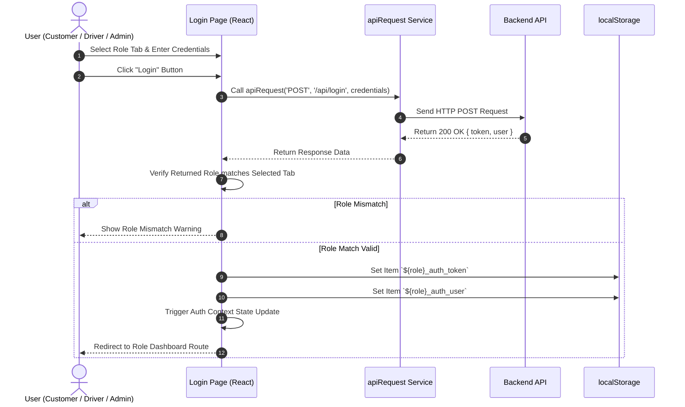
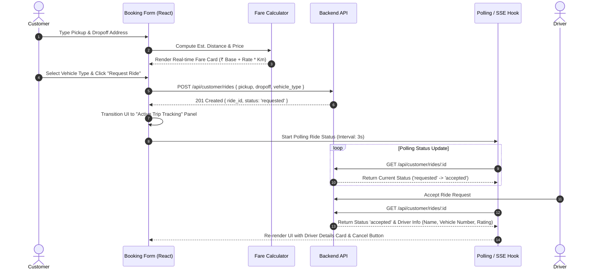

# 🚖 Indian Cabs — Frontend (`cab-frontend`) Documentation

> **Tech Stack:** React 19 + TypeScript · Vite 8 · TailwindCSS 4 · React Router 7 · Lucide Icons

---

## Table of Contents

1. [Introduction](#1-introduction)
2. [Technology Stack](#2-technology-stack)
3. [System Architecture](#3-system-architecture)
4. [Project Structure](#4-project-structure)
5. [Getting Started (Setup & Installation)](#5-getting-started-setup--installation)
6. [Configuration](#6-configuration)
7. [Routing & Navigation](#7-routing--navigation)
   - [Route Definitions](#71-route-definitions)
   - [Role-Based Route Guards](#72-role-based-route-guards)
   - [Multi-Session Architecture](#73-multi-session-architecture)
8. [Authentication Flow](#8-authentication-flow)
   - [Login Flow](#81-login-flow)
   - [Registration Flow](#82-registration-flow)
   - [Logout Flow](#83-logout-flow)
   - [Token Management](#84-token-management)
9. [API Service Layer](#9-api-service-layer)
   - [apiRequest Function](#91-apirequest-function)
   - [calculateFare Function](#92-calculatefare-function)
   - [Error Handling](#93-error-handling)
10. [Components](#10-components)
    - [Login Component](#101-login-component)
    - [Register Component](#102-register-component)
    - [Dashboard Component](#103-dashboard-component)
    - [CustomerDashboard Component](#104-customerdashboard-component)
    - [DriverDashboard Component](#105-driverdashboard-component)
    - [AdminDashboard Component](#106-admindashboard-component)
    - [ThemeToggle Component](#107-themetoggle-component)
11. [Customer Portal Features](#11-customer-portal-features)
    - [Ride Booking](#111-ride-booking)
    - [Active Trip Tracking](#112-active-trip-tracking)
    - [Search Nearby Drivers](#113-search-nearby-drivers)
    - [Ride History & Reviews](#114-ride-history--reviews)
    - [Wallet Management](#115-wallet-management)
12. [Driver Portal Features](#12-driver-portal-features)
    - [Shift Toggle & Scanning Radar](#121-shift-toggle--scanning-radar)
    - [Incoming Ride Requests](#122-incoming-ride-requests)
    - [Trip Control Panel](#123-trip-control-panel)
    - [Vehicle Configuration](#124-vehicle-configuration)
    - [Ride History](#125-ride-history)
13. [Admin Portal Features](#13-admin-portal-features)
    - [Statistics Dashboard](#131-statistics-dashboard)
    - [Driver Roster & Moderation](#132-driver-roster--moderation)
    - [Active Bookings](#133-active-bookings)
    - [Direct Driver Registration](#134-direct-driver-registration)
    - [Ride History](#135-ride-history)
14. [Theme System (Dark/Light Mode)](#14-theme-system-darklight-mode)
15. [UI Design System](#15-ui-design-system)
    - [Color Palette](#151-color-palette)
    - [Typography](#152-typography)
    - [Component Patterns](#153-component-patterns)
    - [Animations & Micro-interactions](#154-animations--micro-interactions)
16. [Backend Compatibility](#16-backend-compatibility)
17. [Error Handling & UX](#17-error-handling--ux)
18. [Build & Deployment](#18-build--deployment)
19. [Book References](#19-book-references)

---

## 1. Introduction

**Indian Cabs — Frontend** (`cab-frontend`) is a modern, single-page application (SPA) built with **React 19** and **TypeScript** that provides the complete user interface for the Indian Cabs Cab Booking System. It serves as the presentation layer that connects to either the Node.js backend (`cab-backend-node`) or the PHP/Laravel backend (`cab-backend-php`) via a RESTful JSON API.

The frontend implements three distinct, role-specific portals:

1. **Customer Portal** (`/customer`) — Ride booking, trip tracking, nearby driver search, wallet management, ride history, and driver ratings
2. **Driver Portal** (`/driver`) — Shift management, incoming request radar, trip control panel, vehicle configuration, and earnings history
3. **Admin Portal** (`/admin`) — Platform analytics dashboard, driver roster management, active bookings monitor, and direct driver onboarding

### Key Highlights

| Feature | Details |
|---|---|
| **Framework** | React 19 with functional components and hooks |
| **Language** | TypeScript 6 for type safety |
| **Build Tool** | Vite 8 with instant HMR (Hot Module Replacement) |
| **Styling** | TailwindCSS 4 utility-first CSS framework |
| **Routing** | React Router DOM 7 with role-based route guards |
| **Icons** | Lucide React (modern Feather Icons fork) |
| **Theme** | Dark/Light mode with localStorage persistence |
| **API Layer** | Custom `fetch` wrapper with role-aware token management |
| **Backend Compatible** | Works with both Node.js and PHP Laravel backends |

---

## 2. Technology Stack

| Technology | Version | Purpose |
|---|---|---|
| **React** | 19.2+ | Declarative, component-based UI library with hooks |
| **TypeScript** | 6.0+ | Statically typed JavaScript superset for type safety |
| **Vite** | 8.2+ | Next-generation build tool with instant Hot Module Replacement |
| **React Router DOM** | 7.18+ | Client-side routing with nested routes and navigation guards |
| **TailwindCSS** | 4.3+ | Utility-first CSS framework for rapid responsive styling |
| **Lucide React** | 1.33+ | Modern, tree-shakable icon library (500+ icons) |
| **@tailwindcss/vite** | 4.3+ | TailwindCSS Vite plugin for optimized CSS compilation |

### Dev Dependencies

| Package | Purpose |
|---|---|
| `@vitejs/plugin-react` | React Fast Refresh and JSX transform for Vite |
| `@types/react` | TypeScript type definitions for React |
| `@types/react-dom` | TypeScript type definitions for React DOM |
| `@types/node` | TypeScript type definitions for Node.js |
| `oxlint` | Fast JavaScript/TypeScript linter |

---

## 3. System Architecture

```
┌──────────────────────────────────────────────────────────────────────────────┐
│                         BROWSER (React SPA)                                  │
│                       http://localhost:5173                                   │
│                                                                              │
│  ┌──────────────┐    ┌──────────────────────────────────────────────────────┐│
│  │   App.tsx     │    │              Role-Based Portals                      ││
│  │  (Router)     │    │                                                      ││
│  │              │    │  ┌──────────────┐ ┌──────────────┐ ┌──────────────┐ ││
│  │ /login  ───────→  │  │  Customer    │ │   Driver     │ │   Admin      │ ││
│  │ /register ────→   │  │  Dashboard   │ │  Dashboard   │ │  Dashboard   │ ││
│  │ /customer ────→   │  │              │ │              │ │              │ ││
│  │ /driver   ────→   │  │ • Book Ride  │ │ • Go Online  │ │ • Stats      │ ││
│  │ /admin    ────→   │  │ • Track Trip │ │ • Accept     │ │ • Users      │ ││
│  │              │    │  │ • Wallet     │ │ • Trip Ctrl  │ │ • Rides      │ ││
│  │              │    │  │ • History    │ │ • Vehicle    │ │ • Add Driver │ ││
│  └──────────────┘    │  │ • Rate       │ │ • History    │ │ • History    │ ││
│                      │  └──────────────┘ └──────────────┘ └──────────────┘ ││
│                      └──────────────────────────────────────────────────────┘│
│                                          │                                   │
│  ┌──────────────────────────────┐        │ apiRequest()                      │
│  │   services/api.ts            │        │ (fetch wrapper)                   │
│  │ • Role-aware token injection │◄───────┘                                   │
│  │ • Error parsing              │                                            │
│  │ • 401 auto-cleanup           │                                            │
│  │ • Fare calculation           │                                            │
│  └──────────────┬───────────────┘                                            │
│                 │ HTTP (JSON)                                                │
└─────────────────┼────────────────────────────────────────────────────────────┘
                  │
                  ▼
    ┌───────────────────────────┐
    │    Backend API Server     │
    │  http://localhost:8000    │
    │                           │
    │  Node.js + Express        │
    │       — OR —              │
    │  PHP + Laravel            │
    └───────────────────────────┘
```

### Data Flow

1. **User** interacts with a React component (e.g., clicks "Book Ride")
2. **Component** calls `apiRequest()` from `services/api.ts`
3. **API Service** injects the correct role-based Bearer token from `localStorage`
4. **Backend** processes the request and returns JSON
5. **Component** updates local state via `useState()` hooks
6. **React** re-renders the UI with updated data

---

## 4. Project Structure

```
cab-frontend/
├── public/
│   └── favicon.jpg                 # Application favicon
├── src/
│   ├── assets/                     # Static assets (images, etc.)
│   ├── components/
│   │   ├── Login.tsx               # Unified login page with role tabs (1164 lines)
│   │   ├── Register.tsx            # Multi-step registration (Customer + Driver)
│   │   ├── Dashboard.tsx           # Legacy dynamic dashboard switcher
│   │   ├── CustomerDashboard.tsx   # ★ Customer portal (1164 lines)
│   │   ├── DriverDashboard.tsx     # ★ Driver portal (1221 lines)
│   │   ├── AdminDashboard.tsx      # ★ Admin portal (686 lines)
│   │   └── ThemeToggle.tsx         # Dark/Light mode toggle button
│   ├── services/
│   │   └── api.ts                  # ★ API service layer (fetch wrapper + fare calc)
│   ├── App.tsx                     # ★ Root component with routing definitions
│   ├── App.css                     # Global application styles
│   ├── index.css                   # Root CSS imports
│   └── main.tsx                    # React DOM entry point
├── dist/                           # Production build output
├── index.html                      # HTML entry point
├── package.json                    # Dependencies and scripts
├── tsconfig.json                   # TypeScript configuration
├── tsconfig.app.json               # App-specific TS config
├── tsconfig.node.json              # Node/Vite TS config
├── vite.config.ts                  # Vite build configuration
└── frontend_documentation.md       # Quick reference documentation
```

### Component Size Overview

| Component | Lines | Size | Complexity |
|---|---|---|---|
| `CustomerDashboard.tsx` | 1,164 | 62 KB | High — booking, tracking, wallet, history, reviews |
| `DriverDashboard.tsx` | 1,221 | 63 KB | High — shift, radar, requests, trip control, vehicle |
| `AdminDashboard.tsx` | 686 | 33 KB | Medium — stats, users, bookings, driver registration |
| `Register.tsx` | 357 | 17 KB | Medium — multi-step form, validation |
| `Login.tsx` | 179 | 8.6 KB | Low — tab selection, form submit |
| `Dashboard.tsx` | 165 | 7.2 KB | Low — legacy role switcher |
| `ThemeToggle.tsx` | 43 | 1.4 KB | Low — theme toggle button |
| `api.ts` | 81 | 3.0 KB | Low — fetch wrapper, fare formula |

---

## 5. Getting Started (Setup & Installation)

### Prerequisites

| Software | Version | Purpose |
|---|---|---|
| Node.js | 18+ | JavaScript runtime |
| npm | 9+ | Package manager |

### Installation

```bash
# 1. Navigate to the frontend directory
cd cab-frontend

# 2. Install dependencies
npm install

# 3. Start development server
npm run dev
```

The dev server starts at `http://localhost:5173` with Hot Module Replacement enabled.

### Available Scripts

| Script | Command | Description |
|---|---|---|
| **dev** | `npm run dev` | Start Vite dev server with HMR |
| **build** | `npm run build` | TypeScript compile + production build |
| **preview** | `npm run preview` | Preview production build locally |
| **lint** | `npm run lint` | Run oxlint code linter |

---

## 6. Configuration

### Vite Configuration (`vite.config.ts`)

```typescript
export default defineConfig({
  plugins: [
    react(),          // React Fast Refresh
    tailwindcss(),    // TailwindCSS v4 Vite plugin
  ],
  server: {
    host: '0.0.0.0',  // Accessible from network
    port: 5173,        // Default dev port
  },
})
```

### API Base URL

The API base URL is configured in `services/api.ts`:

```typescript
const API_BASE_URL = import.meta.env.VITE_API_URL
  || `http://${window.location.hostname}:8000/api`;
```

**Default behavior:** Automatically connects to port 8000 on the same hostname. Override with the `VITE_API_URL` environment variable if needed.

---

## 7. Routing & Navigation

### 7.1 Route Definitions

All routes are defined in `App.tsx` using React Router DOM v7:

| Route | Component | Access |
|---|---|---|
| `/login` | `Login` | Public |
| `/register` | `Register` | Public |
| `/customer` | `CustomerDashboard` | Protected (customer role) |
| `/driver` | `DriverDashboard` | Protected (driver role) |
| `/admin` | `AdminDashboard` | Protected (admin role) |
| `*` (catch-all) | Redirect → `/login` | — |

### 7.2 Role-Based Route Guards

The `RoleProtectedRoute` component wraps each portal route:

```tsx
function RoleProtectedRoute({ children, allowedRole }: {
  children: React.ReactNode;
  allowedRole: string
}) {
  const token = localStorage.getItem(`${allowedRole}_auth_token`);
  const user = JSON.parse(localStorage.getItem(`${allowedRole}_auth_user`) || '{}');

  if (!token) return <Navigate to="/login" replace />;
  if (user.role !== allowedRole) return <Navigate to="/login" replace />;

  return <>{children}</>;
}
```

**How it works:**
1. Checks for a role-specific auth token in `localStorage`
2. Verifies the cached user's role matches the route's required role
3. Redirects to `/login` if either check fails

### 7.3 Multi-Session Architecture

The frontend supports **simultaneous sessions** for different roles. Each role stores its credentials independently:

| Role | Token Key | User Key |
|---|---|---|
| Customer | `customer_auth_token` | `customer_auth_user` |
| Driver | `driver_auth_token` | `driver_auth_user` |
| Admin | `admin_auth_token` | `admin_auth_user` |

**Benefits:**
- Test all three roles in the same browser without logging out
- Each portal maintains its own session state
- Logout only clears the specific role's credentials

---

## 8. Authentication Flow

### 8.1 Login Flow



```
User opens /login
    │
    ▼
┌─────────────────────────┐
│  Select Role Tab:        │
│  Customer | Driver | Admin│
└────────┬────────────────┘
         │ Enter email + password
         ▼
┌─────────────────────────┐
│  POST /api/login         │
│  { email, password }     │
└────────┬────────────────┘
         │
         ▼
┌─────────────────────────┐    ┌──────────────────────────┐
│  Backend returns:        │    │  Verify role matches      │
│  { user, access_token }  │───→│  selected tab             │
└─────────────────────────┘    └────────┬─────────────────┘
                                        │ ✓ Match
                                        ▼
                               ┌──────────────────────────┐
                               │  Store in localStorage:   │
                               │  • {role}_auth_token      │
                               │  • {role}_auth_user       │
                               └────────┬─────────────────┘
                                        │
                                        ▼
                               Navigate to /{role} portal
```

**Key behavior:** The frontend verifies that the returned user's role matches the selected tab. If a customer tries to log in on the Driver tab, they receive an error message.

### 8.2 Registration Flow

The `Register` component supports a **multi-step form**:

**Step 1 — Account Details (all roles):**
- Name, Email, Phone, Password, Confirm Password
- Role selection (Customer or Driver)

**Step 2 — Vehicle Details (drivers only):**
- License Number, Vehicle Model, Plate Number, Vehicle Color
- Vehicle Type selection (Sedan, SUV, Hatchback, Bike, Rickshaw)

**URL parameter:** `/register?role=driver` pre-selects the Driver role.

### 8.3 Logout Flow

```typescript
const handleLogout = (role: 'customer' | 'driver' | 'admin') => {
  if (!window.confirm("Are you sure you want to log out?")) return;
  localStorage.removeItem(`${role}_auth_token`);
  localStorage.removeItem(`${role}_auth_user`);
  window.location.href = '/login';
};
```

- Confirmation dialog before logout
- Only clears the specific role's credentials
- Full page redirect to `/login`

### 8.4 Token Management

The API service layer (`services/api.ts`) automatically determines which token to use based on:

1. **Current URL path** (`/customer`, `/driver`, `/admin`)
2. **API endpoint** (e.g., `/customer/rides`, `/driver/location`, `/admin/dashboard`)
3. **Fallback** — tries all stored tokens if no match

```typescript
let token = null;
const path = window.location.pathname;
if (path.startsWith('/customer') || endpoint.includes('/customer')) {
  token = localStorage.getItem('customer_auth_token');
} else if (path.startsWith('/driver') || endpoint.includes('/driver')) {
  token = localStorage.getItem('driver_auth_token');
} else if (path.startsWith('/admin') || endpoint.includes('/admin')) {
  token = localStorage.getItem('admin_auth_token');
}
```

---

## 9. API Service Layer

### 9.1 `apiRequest` Function

Located in `src/services/api.ts`, this is the central HTTP client for all backend communication:

```typescript
export const apiRequest = async (endpoint: string, options: RequestInit = {}) => {
  // 1. Determine correct auth token based on route/endpoint
  // 2. Set headers: Accept, Content-Type, Authorization
  // 3. Make fetch request to API_BASE_URL + endpoint
  // 4. Parse JSON response
  // 5. Handle errors (401 auto-cleanup, validation error extraction)
  // 6. Return parsed data
};
```

**Headers automatically set:**
- `Accept: application/json`
- `Content-Type: application/json` (unless FormData)
- `Authorization: Bearer <token>` (if token exists)

### 9.2 `calculateFare` Function

Client-side fare calculation that mirrors the backend logic:

```typescript
export const calculateFare = (vehicleType: string, distance: any,
                               pickup?: string, dropoff?: string): number => {
  // Returns 0 if pickup/dropoff empty or distance invalid
  const normalized = (vehicleType || '').toLowerCase();
  let rate = 30; // Car default
  if (normalized === 'bike') rate = 10;
  else if (normalized === 'rickshaw' || normalized === 'auto rickshaw'
           || normalized === 'auto') rate = 20;
  return parsedDist * rate;
};
```

| Vehicle Type | Rate (₹/km) |
|---|---|
| Car (default) | ₹30/km |
| Bike | ₹10/km |
| Rickshaw / Auto | ₹20/km |

### 9.3 Error Handling

**401 Unauthorized responses** automatically clear the relevant role's auth tokens from localStorage, effectively logging the user out.

**Laravel validation errors** are parsed to extract the first specific field error for user-friendly display:

```typescript
if (data.errors && typeof data.errors === 'object') {
  const firstKey = Object.keys(data.errors)[0];
  if (firstKey && Array.isArray(data.errors[firstKey])) {
    errorMessage = data.errors[firstKey][0];
  }
}
```

---

## 10. Components

### 10.1 Login Component

**File:** `src/components/Login.tsx` (179 lines)

| Feature | Details |
|---|---|
| **Role Tabs** | Customer, Driver, Admin — each with distinct icon (User, Car, Shield) |
| **Form Fields** | Email, Password (with show/hide toggle) |
| **Validation** | Client-side role verification after login |
| **UI** | Glassmorphism card, decorative gradient orbs, dark/light theme support |
| **Navigation** | Links to Register page; redirects to role-specific portal on success |
| **Theme** | ThemeToggle in top-right corner |

### 10.2 Register Component

**File:** `src/components/Register.tsx` (357 lines)

| Feature | Details |
|---|---|
| **Multi-step Form** | Step 1: Account details → Step 2: Vehicle details (driver only) |
| **Role Selection** | Customer or Driver (driven by URL param `?role=driver`) |
| **Vehicle Types** | Dropdown: Sedan, SUV, Hatchback, Bike, Rickshaw |
| **Validation** | Password confirmation, required fields |
| **Auto-login** | On successful registration, stores token and redirects to portal |

### 10.3 Dashboard Component

**File:** `src/components/Dashboard.tsx` (165 lines)

Legacy dynamic role-switching dashboard. Fetches `/api/me` and renders the appropriate portal. Currently unused in the main `App.tsx` routing (replaced by direct role routes).

### 10.4 CustomerDashboard Component

**File:** `src/components/CustomerDashboard.tsx` (1,164 lines)

The most complex component, implementing the full customer experience. See [Section 11](#11-customer-portal-features) for detailed feature documentation.

**Props:** `{ user: any, onLogout: () => void }`

### 10.5 DriverDashboard Component

**File:** `src/components/DriverDashboard.tsx` (1,221 lines)

Implements the complete driver workflow from going online to completing rides. See [Section 12](#12-driver-portal-features) for detailed feature documentation.

**Props:** `{ user: any, onLogout: () => void }`

### 10.6 AdminDashboard Component

**File:** `src/components/AdminDashboard.tsx` (686 lines)

Platform management dashboard with statistics, user management, and ride monitoring. See [Section 13](#13-admin-portal-features) for detailed feature documentation.

**Props:** `{ user: any, onLogout: () => void }`

### 10.7 ThemeToggle Component

**File:** `src/components/ThemeToggle.tsx` (43 lines)

| Feature | Details |
|---|---|
| **Default** | Dark mode (modern aesthetic preference) |
| **Persistence** | Saves preference to `localStorage('theme')` |
| **Mechanism** | Toggles `dark` class on `document.documentElement` |
| **Icons** | Sun (dark mode → switch to light), Moon (light mode → switch to dark) |
| **Animation** | Hover rotation effect (Sun: 45°, Moon: -12°) |

---

## 11. Customer Portal Features

### 11.1 Ride Booking

**Tab:** "Book a Ride"

| Feature | Implementation |
|---|---|
| **Pickup/Dropoff Input** | Text address fields with coordinate resolution |
| **Vehicle Selection** | Car, Bike, Rickshaw — visual cards with rate display |
| **Fare Preview** | Real-time fare estimation using `calculateFare()` as user types |
| **Distance Calculation** | Computed from GPS coordinates (sent to backend) |
| **Payment Method** | Cash, Card, Wallet selection |
| **Submit** | `POST /api/customer/rides` with full payload |
| **Driver Availability** | Backend validates driver availability for selected vehicle type |

**Booking Flow:**
1. Enter pickup and dropoff locations
2. Select vehicle type (fare preview updates instantly)
3. Choose payment method
4. Click "Request Ride" → ride created with `requested` status
5. UI transitions to Active Trip Tracking view



### 11.2 Active Trip Tracking

**Panel:** "Active Trip Status"

| Feature | Implementation |
|---|---|
| **Status Badges** | Color-coded badges for each ride status |
| **Progress Bar** | Animated progress bar that smoothly fills based on ride status |
| **Smooth Animation** | `displayProgress` interpolates toward `progressPercentage` at ~1% per 500ms |
| **Driver Info** | Assigned driver name, phone, vehicle details |
| **ETA Countdown** | Estimated pickup time countdown |
| **Cancel Button** | Available during `requested`, `accepted`, `waiting_for_customer` statuses |
| **Auto-Refresh** | Periodic polling for status updates |

**Progress Mapping:**

| Ride Status | Progress % |
|---|---|
| `requested` | 10% |
| `accepted` | 30% |
| `waiting_for_customer` | 50% |
| `in_progress` | 75% |
| `completed` | 100% |

### 11.3 Search Nearby Drivers

**Tab:** "Search Nearby Drivers"

- Submits GPS coordinates via `GET /api/customer/drivers/nearby`
- Displays available drivers sorted by distance
- Shows driver name, vehicle info, rating, and distance

### 11.4 Ride History & Reviews

**Tab:** "Ride History"

| Feature | Implementation |
|---|---|
| **Filters** | All, Completed, Cancelled |
| **Tab Toggle** | Trips vs. Wallet transaction history |
| **Ride List** | Chronological list with status, fare, driver info |
| **Rate Button** | Available on completed rides without existing reviews |
| **Star Rating** | Interactive 1–5 star rating modal |
| **Comment** | Optional text comment with review |
| **API Call** | `POST /api/customer/rides/{id}/rate` |

### 11.5 Wallet Management

| Feature | Implementation |
|---|---|
| **Balance Display** | Current wallet balance in header (cached per user in localStorage) |
| **Recharge Modal** | Quick-amount buttons + custom input field |
| **Minimum** | ₹1 per recharge |
| **Maximum** | ₹2,000 wallet balance cap |
| **Transaction List** | Recent deposits, payments, and refunds |
| **Per-User Caching** | Balance cached with user-specific key: `customer_wallet_balance_{userId}` |
| **Profile Modal** | View user details (name, email, phone, role) |

---

## 12. Driver Portal Features

### 12.1 Shift Toggle & Scanning Radar

| Feature | Implementation |
|---|---|
| **Go Online/Offline** | Toggle switch that calls `POST /api/driver/location` with `is_available: true/false` |
| **Location Broadcast** | Sends GPS coordinates with availability update |
| **Pulse Radar** | Animated radar scanning effect while online and waiting for requests |
| **Status Indicator** | Visual status: Offline → Online → Scanning → Request Found → Active Trip |

### 12.2 Incoming Ride Requests

**Panel:** "🚨 NEW RIDE REQUEST FOUND!"

| Feature | Implementation |
|---|---|
| **Polling** | Periodically calls `GET /api/driver/rides/requests` when online |
| **Request Card** | Displays pickup/dropoff, distance, customer info, estimated fare |
| **Countdown Timer** | 8-second auto-dismiss timer for incoming requests |
| **Accept Button** | `POST /api/driver/rides/{id}/accept` |
| **Decline** | Dismisses current request, continues scanning |
| **Timer Ref** | Uses `useRef` to prevent double-execution in StrictMode |

### 12.3 Trip Control Panel

**Panel:** "On the way to Pickup"

| Feature | Implementation |
|---|---|
| **Status Buttons** | Sequential progression: Arrived → Pick Up → Complete |
| **API Call** | `POST /api/driver/rides/{id}/status` with next status |
| **Progress Bar** | Visual trip progress indicator |
| **Smooth Animation** | `displayProgress` smoothly animates toward target |
| **Customer Info** | Customer name, phone, pickup/dropoff addresses |
| **Ride Details** | Distance, fare, vehicle type, duration |

**Status Progression:**

| Button | Sends Status | Meaning |
|---|---|---|
| "Arrived at Pickup" | `waiting_for_customer` | Driver has arrived |
| "Start Trip" | `in_progress` | Customer has boarded |
| "Complete Trip" | `completed` | Arrived at destination |

### 12.4 Vehicle Configuration

**Modal:** "Vehicle Details"

| Feature | Implementation |
|---|---|
| **View** | Current vehicle model, plate number, color, type |
| **Edit** | Modify all vehicle fields |
| **Register** | Register new vehicle (if none exists) |
| **API Calls** | `POST /api/driver/vehicle`, `PUT /api/driver/vehicle` |

### 12.5 Ride History

| Feature | Implementation |
|---|---|
| **List** | Chronological ride history with status, fare, customer info |
| **Filters** | All, Completed, Cancelled |
| **Details** | Pickup/dropoff, distance, duration, payment info |
| **Wallet Balance** | Driver can view their earnings wallet |

---

## 13. Admin Portal Features

### 13.1 Statistics Dashboard

**Grid:** Statistics Cards

| Card | Source | Description |
|---|---|---|
| **Earnings** | `GET /api/admin/dashboard` → `stats.total_earnings` | Total platform commission earnings |
| **Completed Rides** | `stats.total_completed_rides` | Count of completed trips |
| **Online Drivers** | `stats.active_drivers_online` | Currently active drivers |
| **Total Users** | `stats.total_users` | All registered users |

### 13.2 Driver Roster & Moderation

**Table:** "Driver Roster"

| Feature | Implementation |
|---|---|
| **List** | `GET /api/admin/users?role=driver` |
| **Columns** | Name, Email, Phone, Vehicle, Status, Actions |
| **Suspend** | `PATCH /api/admin/users/{id}/status` → `{ status: "suspended" }` |
| **Activate** | `PATCH /api/admin/users/{id}/status` → `{ status: "active" }` |
| **Delete** | `DELETE /api/admin/users/{id}` (with active ride check) |
| **Icons** | `UserMinus` for suspend, `UserCheck` for activate |

### 13.3 Active Bookings

**Table:** "Active Bookings"

| Feature | Implementation |
|---|---|
| **Source** | `GET /api/admin/rides` |
| **Filter** | Rides in intermediate states (requested, accepted, arrived, in_progress) |
| **Columns** | ID, Customer, Driver, Status, Pickup, Dropoff, Fare |
| **Refresh** | Manual refresh button |

### 13.4 Direct Driver Registration

**Modal:** "Add New Driver"

| Feature | Implementation |
|---|---|
| **Form Fields** | Name, Email, Phone, Password, License, Vehicle Model, Plate, Color, Type |
| **Vehicle Types** | Sedan, SUV, Hatchback, Bike, Rickshaw |
| **API** | `POST /api/register` (with `role: "driver"`) |
| **Validation** | Client-side required fields + server-side uniqueness checks |

### 13.5 Ride History

| Feature | Implementation |
|---|---|
| **List** | All rides (paginated) |
| **Filters** | All, Completed, Cancelled |
| **Details** | Customer, Driver, Status, Fare, Payment Info |

---

## 14. Theme System (Dark/Light Mode)

### Implementation

The theme system uses TailwindCSS's `dark:` variant with a manual class strategy:

```typescript
// ThemeToggle.tsx
useEffect(() => {
  if (isDark) {
    document.documentElement.classList.add('dark');
    localStorage.setItem('theme', 'dark');
  } else {
    document.documentElement.classList.remove('dark');
    localStorage.setItem('theme', 'light');
  }
}, [isDark]);
```

### Default Theme

**Dark mode** is the default (modern aesthetic preference). Users can toggle to light mode.

### Persistence

Theme preference is stored in `localStorage` under the key `theme` and restored on page load.

### Usage in Components

```tsx
// Dark background with light mode override
className="bg-slate-50 dark:bg-[#050505]"

// Text color with theme awareness
className="text-slate-900 dark:text-slate-100"

// Border colors
className="border-slate-200 dark:border-neutral-800"
```

---

## 15. UI Design System

### 15.1 Color Palette

| Usage | Light Mode | Dark Mode |
|---|---|---|
| **Background** | `slate-50` (#f8fafc) | `#050505` (near black) |
| **Card Background** | `white` | `#0c0c0e` |
| **Primary Accent** | `amber-500` | `amber-400` / `amber-500` |
| **Secondary Accent** | `purple-500` / `indigo-500` | `purple-600` / `indigo-500` |
| **Text Primary** | `slate-900` | `slate-100` / `white` |
| **Text Secondary** | `slate-500` | `neutral-400` |
| **Borders** | `slate-200` | `neutral-800` / `neutral-900` |
| **Success** | `green-500` | `green-400` |
| **Error** | `red-500` | `red-400` |
| **Warning** | `amber-500` | `amber-400` |

### 15.2 Typography

- **Font Family:** System sans-serif (`font-sans`)
- **Brand Title:** `text-3xl font-extrabold tracking-tight`
- **Section Headers:** `text-xl font-bold`
- **Body Text:** `text-sm font-medium`
- **Labels:** `text-xs font-semibold`

### 15.3 Component Patterns

| Pattern | Usage | Example |
|---|---|---|
| **Glassmorphism Cards** | Login, modals | `bg-white/80 backdrop-blur-xl border rounded-3xl shadow-xl` |
| **Gradient Orbs** | Background decoration | `bg-purple-500/10 rounded-full blur-3xl animate-pulse` |
| **Rounded Containers** | Cards, buttons | `rounded-3xl`, `rounded-2xl`, `rounded-xl` |
| **Icon Badges** | Feature icons | `w-16 h-16 rounded-3xl bg-amber-500/10 border border-amber-500/20` |
| **Toast Notifications** | Success/error alerts | Auto-dismissing toast stack with slide-in animation |
| **Tab Navigation** | Section switching | Horizontal tab bar with active indicator |
| **Status Badges** | Ride status | Color-coded pill badges (`bg-green-500/10 text-green-400`) |
| **Modal Overlays** | Forms, dialogs | Fixed overlay with centered card, backdrop blur |

### 15.4 Animations & Micro-interactions

| Animation | Usage |
|---|---|
| **Pulse Radar** | Driver scanning for ride requests |
| **Progress Bar Animation** | Smooth fill on ride status changes (1% per 500ms) |
| **Hover Scale** | `hover:scale-105 active:scale-95` on interactive elements |
| **Icon Rotation** | Theme toggle icons rotate on hover |
| **Countdown Timer** | Request expiry countdown with visual urgency |
| **Fade Transitions** | `transition-all duration-200` / `duration-300` on most elements |
| **Gradient Orb Pulse** | `animate-pulse` on decorative background elements |
| **Spin Loader** | `animate-spin` on loading indicators |
| **Toast Slide-in** | Auto-dismissing notification slide effect |

---

## 16. Backend Compatibility

The frontend is designed to work seamlessly with **both** backend implementations:

| Backend | Port | API Prefix | Auth Mechanism |
|---|---|---|---|
| `cab-backend-node` (Node.js + Express) | 8000 | `/api` | JWT (jsonwebtoken) |
| `cab-backend-php` (PHP + Laravel) | 8000 | `/api` | Laravel Sanctum Bearer Token |

### Why Both Work

1. **Identical API endpoints** — Both backends expose the same routes (`/api/login`, `/api/customer/rides`, etc.)
2. **Same request/response format** — JSON payloads with identical structure
3. **Same status codes** — Both use standard HTTP status codes (200, 201, 401, 403, 422)
4. **Bearer token auth** — Both accept `Authorization: Bearer <token>` headers
5. **Same validation error format** — Both return `{ message, errors: { field: [messages] } }`

### Switching Backends

Simply start the desired backend on port 8000 and the frontend will connect automatically:

```bash
# Use Node.js backend
cd cab-backend-node && npm run dev

# OR use PHP/Laravel backend
cd cab-backend-php && php artisan serve --port=8000

# Then start frontend (always the same)
cd cab-frontend && npm run dev
```

---

## 17. Error Handling & UX

### Error Display Patterns

| Error Type | Display Method |
|---|---|
| **Login/Register Errors** | Inline error message below the form |
| **API Errors** | Toast notification (auto-dismissing) |
| **Validation Errors** | Extracts first field-specific error from backend response |
| **Network Errors** | Generic "Something went wrong" toast |
| **401 Unauthorized** | Auto-clears tokens, user must re-login |

### Loading States

| Operation | Indicator |
|---|---|
| **Login/Register** | Button disabled with loading text |
| **Data Fetching** | Spinning loader animation |
| **Ride Booking** | Button disabled, "Requesting..." text |
| **Status Update** | Button disabled during API call |
| **Dashboard Load** | Full-screen centered spinner with "Verifying active session..." |

### Toast Notification System

Each dashboard component implements a toast system:

```typescript
const [toasts, setToasts] = useState<{
  id: number;
  message: string;
  type: 'success' | 'error'
}[]>([]);

const addToast = (message: string, type: 'success' | 'error' = 'success') => {
  const id = Date.now();
  setToasts(prev => [...prev, { id, message, type }]);
  setTimeout(() => setToasts(prev => prev.filter(t => t.id !== id)), 3500);
};
```

---

## 18. Build & Deployment

### Production Build

```bash
cd cab-frontend
npm run build
```

This runs TypeScript compilation (`tsc -b`) followed by Vite's production bundler. Output is written to the `dist/` directory.

### Build Output

```
dist/
├── index.html          # Entry HTML
├── assets/
│   ├── index-*.js      # Bundled JavaScript
│   └── index-*.css     # Compiled TailwindCSS
└── favicon.jpg         # Static assets
```

### Preview Production Build

```bash
npm run preview
```

Serves the `dist/` directory locally for testing before deployment.

### Deployment Notes

1. **Static Hosting** — The built `dist/` directory can be deployed to any static file server (Nginx, Apache, Netlify, Vercel, S3)
2. **SPA Routing** — Configure the server to redirect all routes to `index.html` for client-side routing
3. **API URL** — Set `VITE_API_URL` environment variable during build to point to the production backend
4. **CORS** — Ensure the backend allows requests from the frontend's deployed domain

---

## 19. Book References

The following books and resources were referenced during the design, development, and documentation of this project:

| # | Title | Author(s) | Publisher / Year | Relevance |
|---|---|---|---|---|
| 1 | *Learning React: Modern Patterns for Developing React Apps* (2nd Edition) | Alex Banks, Eve Porcello | O'Reilly Media, 2020 | React component design, hooks, state management, and SPA architecture |
| 2 | *Programming TypeScript* | Boris Cherny | O'Reilly Media, 2019 | TypeScript type system, generics, and advanced patterns |
| 3 | *RESTful Web APIs: Services for a Changing World* | Leonard Richardson, Mike Amundsen, Sam Ruby | O'Reilly Media, 2013 | REST API design principles, HTTP methods, and client-server communication |
| 4 | *Software Engineering* (10th Edition) | Ian Sommerville | Pearson, 2015 | Software engineering principles, SDLC models, UI design patterns |
| 5 | *Don't Make Me Think, Revisited* | Steve Krug | New Riders, 2014 | Web usability principles and intuitive UI design |
| 6 | *Software Testing: Principles and Practices* | Srinivasan Desikan, Gopalaswamy Ramesh | Pearson Education India, 2006 | Testing strategies and user acceptance testing |
| 7 | *Clean Code: A Handbook of Agile Software Craftsmanship* | Robert C. Martin | Prentice Hall, 2008 | Code quality, component design, and maintainability |

### Online Resources

| # | Resource | URL | Usage |
|---|---|---|---|
| 1 | React Official Documentation | https://react.dev | Component lifecycle, hooks reference, and best practices |
| 2 | TailwindCSS Documentation | https://tailwindcss.com/docs | Utility-first CSS classes, dark mode, and responsive design |
| 3 | Vite Documentation | https://vite.dev | Build configuration, HMR, and environment variables |
| 4 | React Router Documentation | https://reactrouter.com | Client-side routing patterns and route guards |
| 5 | TypeScript Handbook | https://www.typescriptlang.org/docs | TypeScript language reference and React patterns |
| 6 | Lucide Icons | https://lucide.dev | Icon library reference and usage guide |
| 7 | MDN Web Docs — JavaScript | https://developer.mozilla.org | JavaScript language reference and Fetch API |

---

> **End of Documentation**
> Indian Cabs — Frontend (`cab-frontend`)
> For questions or contributions, refer to the project repository.
